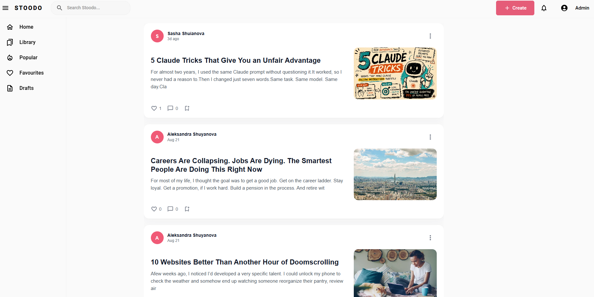
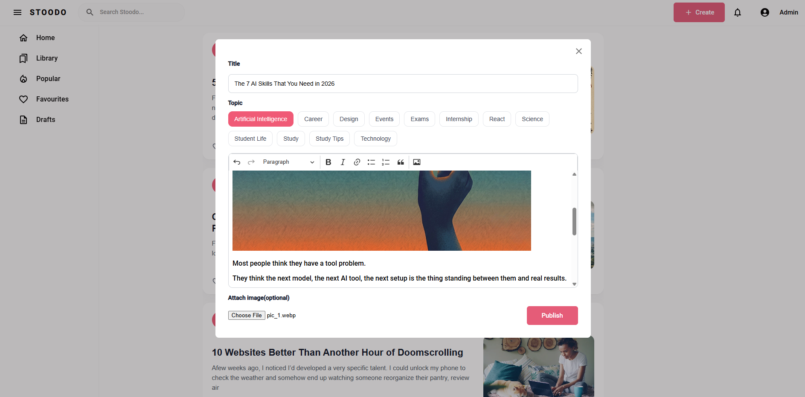
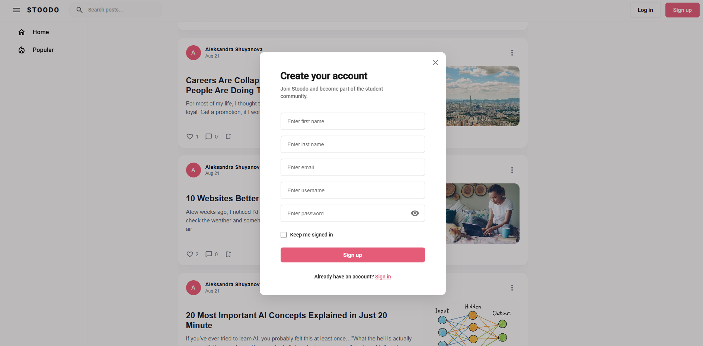
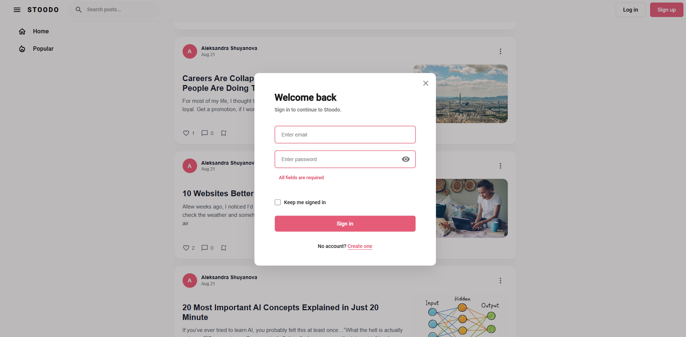

# Stoodo

A full-stack blogging platform for students: write posts in a rich-text editor, attach images, pick a topic, search the feed and like what you read.

- **Backend** (this repo): REST API on Node.js, Express and PostgreSQL
- **Frontend** ([stoodo-frontend](https://github.com/AlexandraShuyanova/stoodo-frontend), included as a git submodule in `frontend/stoodo`): Next.js, React, Redux Toolkit

## Screenshots

<table>
  <tr>
    <td width="50%"><b>Feed</b><br></td>
    <td width="50%"><b>Post page</b><br></td>
  </tr>
  <tr>
    <td width="50%"><b>Create a post</b><br></td>
    <td width="50%"><b>Sign up</b><br></td>
  </tr>
  <tr>
    <td width="50%"><b>Form validation</b><br></td>
    <td></td>
  </tr>
</table>

## Features

- **Authentication**: registration and login with JWT access tokens, passwords hashed with bcrypt, the session is dropped automatically when the token expires
- **Feed**: published posts with author, date, preview text and cover image
- **Search**: debounced search by post title
- **Rich-text editor**: posts are written in CKEditor (headings, bold/italic, links, lists, quotes, inline images)
- **Topics**: every post belongs to a topic, selectable with chips in the editor
- **Image upload**: cover and inline images are stored in Cloudflare R2
- **Likes**: like and unlike a post, live counter, per-user interaction state
- **Post pages**: server-side rendered with `<title>` and Open Graph tags for link previews
- **Moderation**: posts from regular users are created unpublished and appear in the feed only after approval; admin posts are published immediately
- **Form validation**: empty fields are highlighted and the error is shown inline

## Tech stack

| Layer | Technologies |
|---|---|
| Backend | Node.js, TypeScript, Express 5, Prisma, PostgreSQL, JWT, bcrypt, multer |
| Storage | Cloudflare R2 (S3-compatible API) |
| Frontend | Next.js (Pages Router, SSR), React, TypeScript, Redux Toolkit, RTK Query, MUI, SCSS modules, CKEditor 5 |

## Architecture

```
Browser ──► Next.js (:3001) ──rewrites /api/v1/*──► Express API (:3000) ──► PostgreSQL
                                                          └──────────────► Cloudflare R2 (images)
```

- Next.js proxies `/api/v1/*` to the API through `rewrites` in `next.config.js`, so the browser talks to a single origin.
- RTK Query handles data fetching and caching. Mutations invalidate tags: creating a post refreshes the feed, liking a post refreshes its counter.
- Access control: protected routes use an Express middleware that verifies the JWT signature; the user role is read from the verified token.

## Getting started

### Backend

```bash
git clone --recurse-submodules https://github.com/AlexandraShuyanova/stoodo-api-node
cd stoodo-api-node
npm install
cp .env.example .env   # fill in the values
npx prisma migrate deploy
npx prisma generate
npm run dev
```

The API starts on `http://localhost:3000`.

### Frontend

```bash
cd frontend/stoodo
npm install
npm run dev
```

The site starts on `http://localhost:3001`.

## Environment variables

| Variable | Description |
|---|---|
| `DATABASE_URL` | PostgreSQL connection string |
| `JWT_SECRET` | Secret for signing tokens (use a long random string) |
| `JWT_EXPIRES_IN` | Token lifetime |
| `R2_ENDPOINT` | Cloudflare R2 endpoint |
| `R2_ACCESS_KEY_ID` | R2 access key |
| `R2_SECRET_ACCESS_KEY` | R2 secret key |
| `R2_BUCKET_NAME` | R2 bucket name |
| `R2_PUBLIC_URL` | Public base URL for uploaded images |

## API

Base path: `/api/v1`. 🔒 = requires `Authorization: Bearer <token>`.

| Method | Path | Description |
|---|---|---|
| POST | `/auth/register` | Register a user |
| POST | `/auth/login` | Log in, returns an access token |
| GET | `/auth/user_info` | Current user info |
| GET | `/post/posts?search=` | List published posts, optionally filtered by title |
| GET | `/post/post_by_slug/:slug` | Get a post by slug |
| GET | `/post/post_stat/:id` | Likes count for a post |
| GET | `/post/user_interaction_by_post/:id` 🔒 | Current user's interaction with a post |
| POST | `/post/create` 🔒 | Create a post |
| POST | `/post/like_post/:id?isLiked=` 🔒 | Like or unlike a post |
| GET | `/topic/topics` | List topics |
| POST | `/image/upload` 🔒 | Upload an image (multipart, field `file`) |

## Roadmap

- [ ] Pagination / infinite scroll for the feed
- [ ] Refresh tokens (the `refresh_tokens` table is already in the schema)
- [ ] Comments, bookmarks (Library), Favourites and Drafts pages
- [ ] Input validation and rate limiting on the API
- [ ] Automated tests (Jest + React Testing Library for the UI, supertest for the API)
